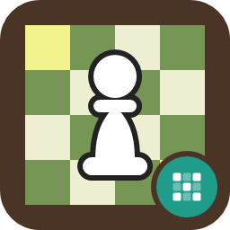

# E2e4.Chess.Logic



A small, dependency-free chess rules library for .NET: bitboard move generation, a `Position` model with `Make`/`Unmake`, FEN parsing
and validation, Zobrist hashing, `PositionSetup` for editing and validating positions, and game records with variations that read and
write PGN. It targets `net45`, `netstandard2.0`,
`netstandard2.1`, `net10.0` and `net11.0`, so it runs on old and new runtimes and on Linux, macOS and Windows. Install from NuGet:
`E2e4.Chess.Logic`.

Move generation is checked against published perft node counts for the standard test positions.

```csharp
var position = new Position(Position.StartingFEN);

List<int> moves = position.LegalMoves();
Console.WriteLine(moves.Count);                          // 20
Console.WriteLine(Move.GetCoordinateNotation(moves[0]));

position.Make(moves[0]);
Console.WriteLine(position.GetFEN());
position.Unmake(moves[0]);

if (Position.TryParse("not a fen", out Position? parsed)) { /* never reached */ }
```

Moves are plain `int`s that `Move` packs and unpacks (`Move.From`, `Move.To`, `Move.IsCapture`, ...). `Position` exposes its state read-only
(`Squares`, `SideToMove`, `Castling`, `EnPassantSquare`, `ZobristKey`, ...). `LegalMoves(int[])` avoids allocating; on `netstandard2.1`,
`net10.0` and `net11.0` there is also `LegalMoves(Span<int>)`.

For a position editor, `PositionSetup` accepts any arrangement while it is being edited, `Validate()` lists the problems
(`PositionProblem`), and `ToPosition()` returns the playable `Position` once it is legal.

For teaching tools, `Position` answers "why" questions about the board: `AttackersOf`, `DefendersOf`, `AttacksFrom`, `Checkers`, `Pins` and
`HangingPieces` list squares (and `Pin`s), `LegalMovesFrom` and `Move.Find` classify a drag or arrow, and `Square.SameLine`/`Between` give the
geometry of files, ranks and diagonals.

## Games

`Move.FromAlgebraicNotation` reads a move in standard algebraic notation (`Nbd7`, `exd6`, `e8=Q+`, `O-O`), leniently about marks such as
`+`, `!` and `0-0`, and returns `Move.Invalid` for an illegal or ambiguous move.

The `E2e4.Chess.Logic.Games` namespace holds whole games:

```csharp
using E2e4.Chess.Logic.Games;

Pgn.TryParseGame("1. e4 e5 (1... c5 2. Nf3) 2. Nf3 {A comment} Nc6 *", out GameRecord? game);

foreach (GameNode node in game!.MainLine())
    Console.WriteLine($"{node} -> {node.Fen}");      // "1. e4 -> rnbqkbnr/...", ...

GameNode e4 = game.Root.Next!;
e4.TryAddMove("e6", out GameNode? french);           // another variation
Console.WriteLine(Pgn.Write(game));
```

- `GameRecord` holds the tags, the start position and a tree of `GameNode`s. A node's `Children[0]` continues the main line and the
  others are variations. Each node stores its `Fen`, `ZobristKey` and `San` when it is added, so showing any move on a board is a lookup;
  `ToPosition()` replays the game to give a playable `Position` with its history. Nodes also carry `Comment`, `PreComment`, `Nags`,
  `Clock` and `MoveTime`, and can be promoted, demoted and removed; `GetPath()` and `GameRecord.NodeAt` address any node.
- `Pgn` reads and writes PGN with variations, comments, NAGs and `[%clk]`/`[%emt]` times. Reading is lenient: an illegal move ends its
  line, the problem goes into `GameRecord.Errors`, and it never throws. `PgnCommand` finds other `[%name args]` commands in comments,
  such as the `[%cal]` arrows and `[%csl]` squares a board might draw.
- `GameEncoding` packs a game into a compact binary form (two bytes per move), and `PositionIndex` collects games into an opening index
  keyed by position, so transpositions share one entry, with move counts and results.

## Notes

- `Position.TryParse` and `PositionSetup.TryParse` return `false` on bad input instead of throwing; they share one parser, so they accept
  the same FEN (a bare placement is fine, repeated castling letters are not) and `Position` accepts exactly what `PositionSetup.Validate()`
  reports no errors for. Warnings (a position no game could reach, or one that has ended) do not stop a `Position`.
  `Make`/`Unmake` throw at the ply limit
  (`Position.HalfMovesLimit`) rather than overrun their buffers.
- The library does no I/O and holds no global state; a `Position` is not thread-safe, so give each thread its own (`DeepClone`). The same
  goes for a `GameRecord` and its nodes.
- A `Position`'s history grows as moves are made, so a new one is small (a little over 1 KB of history) until a game gets long.

## Build and test

```
dotnet test E2e4.Chess.Logic.slnx
```

See [SECURITY.md](https://github.com/th3snark/E2e4.Chess.Logic/blob/master/SECURITY.md) to report a vulnerability.

## Licence

MIT, see [LICENSE](https://github.com/th3snark/E2e4.Chess.Logic/blob/master/LICENSE). No dependencies.
