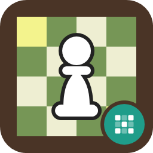

# E2e4.Chess.Logic



A small, dependency-free chess rules library for .NET: bitboard move generation, a `Position` model with `Make`/`Unmake`, FEN parsing
and validation, Zobrist hashing, and `PositionSetup` for editing and validating positions. It targets `net45`, `netstandard2.0`,
`netstandard2.1` and `net10.0`, so it runs on old and new runtimes and on Linux, macOS and Windows. Install from NuGet:
`E2e4.Chess.Logic`.

Move generation is checked against published perft node counts for the standard test positions.

```csharp
var position = new Position(Position.StartingFEN);

List<int> moves = position.LegalMoves();
Console.WriteLine(moves.Count);                          // 20
Console.WriteLine(Move.GetCoordinateNotation(moves[0]));

position.Make(moves[0]);
Console.WriteLine(position.GetFEN());
position.Unmake(moves[0]);

if (Position.TryParse("not a fen", out Position? parsed)) { /* never reached */ }
```

Moves are plain `int`s that `Move` packs and unpacks (`Move.From`, `Move.To`, `Move.IsCapture`, ...). `Position` exposes its state read-only
(`Squares`, `SideToMove`, `Castling`, `EnPassantSquare`, `ZobristKey`, ...). `LegalMoves(int[])` avoids allocating; on `netstandard2.1`
and `net10.0` there is also `LegalMoves(Span<int>)`.

For a position editor, `PositionSetup` accepts any arrangement while it is being edited, `Validate()` lists the problems
(`PositionProblem`), and `ToPosition()` returns the playable `Position` once it is legal.

## Notes

- `Position.TryParse` and `PositionSetup.TryParse` return `false` on bad input instead of throwing; they share one parser, so they accept
  the same FEN (a bare placement is fine, repeated castling letters are not) and `Position` accepts exactly what `PositionSetup.Validate()`
  reports no errors for. Warnings (a position no game could reach, or one that has ended) do not stop a `Position`.
  `Make`/`Unmake` throw at the ply limit
  (`Position.HalfMovesLimit`) rather than overrun their buffers.
- The library does no I/O and holds no global state; a `Position` is not thread-safe, so give each thread its own (`DeepClone`).

## Build and test

```
dotnet test E2e4.Chess.Logic.slnx
```

See [SECURITY.md](https://github.com/th3snark/E2e4.Chess.Logic/blob/master/SECURITY.md) to report a vulnerability.

## Licence

MIT, see [LICENSE](https://github.com/th3snark/E2e4.Chess.Logic/blob/master/LICENSE). No dependencies.
